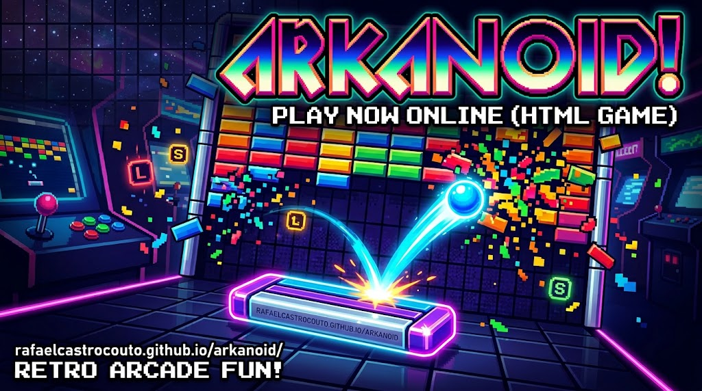

# Arkanoid



Arkanoid is a fast-paced arcade brick-breaker inspired by the classic block-smashing games of the 80s. Built with JavaScript and HTML5, it delivers a neon-styled, browser-based challenge where you control a paddle, bounce a ball, and destroy every brick in sight.

Play the game on itch.io: [Arkanoid on itch.io](https://racascou.itch.io/arkanoid)

## Features

- Classic break-out gameplay with addictive score chasing
- Multiple levels with increasingly difficult layouts
- Power-ups and dynamic arcade action
- Responsive HTML5 canvas rendering in the browser
- Lightweight project structure with no heavy dependencies

## Quick start

You can play the game directly in a browser by opening the project in a local web server.

### Run locally

From the project root:

```bash
python -m http.server 8000
```

Then open:

```text
http://localhost:8000
```

You can also open `index.html` directly in a browser, although a local web server is recommended for the most reliable experience.

## Controls

- Left arrow / A: move paddle left
- Right arrow / D: move paddle right
- Space: launch the ball / start the round
- Mouse/touch: depending on browser support and game configuration, the paddle can also be controlled with pointer movement

## How to play

1. Move the paddle to position it under the ball.
2. Launch the ball to begin play.
3. Break all bricks in the current level.
4. Keep the ball in play and avoid letting it fall below the paddle.
5. Clear each stage to progress and increase your score.

## Project structure

- `index.html` - main page entry point
- `js/` - game logic and browser scripts
- `css/` - styling and UI presentation
- `audio/` - game sound assets
- `font/` - custom font files
- `banner.jpg` - banner used in this README

## Documentation and support

- Project wiki: [Help](https://github.com/rafaelcastrocouto/arkanoid/wiki)
- Bug reports and feedback: [Issues](https://github.com/rafaelcastrocouto/arkanoid/issues)

## License

This project is released under the [GPL License](http://opensource.org/licenses/gpl-3.0.html).
